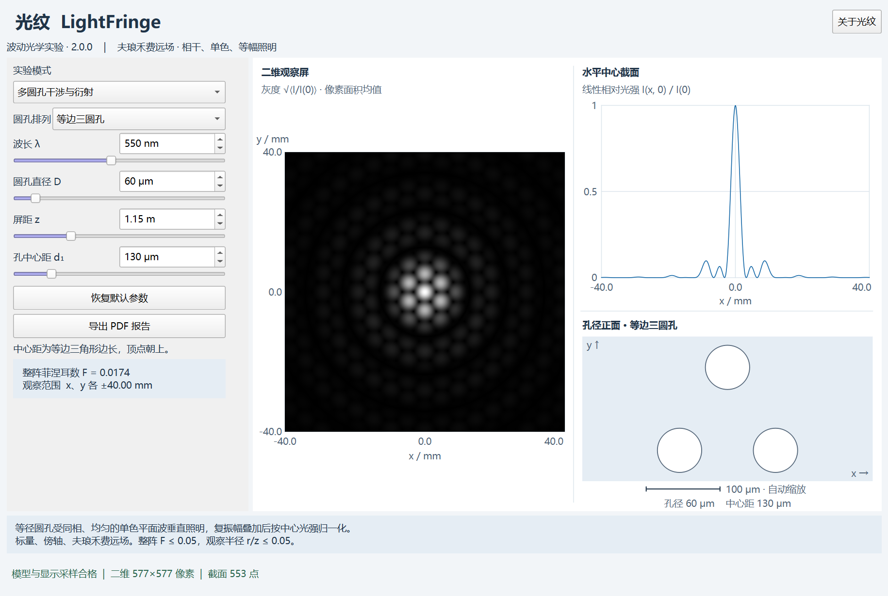
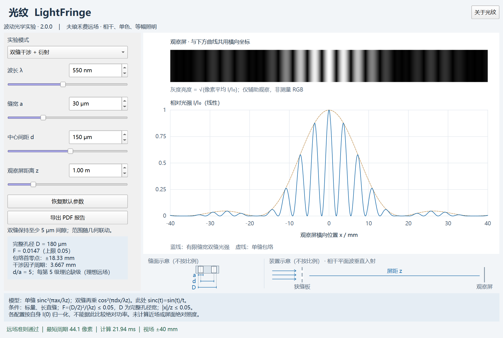

# 光纹 LightFringe

光纹 LightFringe 是一款用于光学教学、演示与个人探索的 **Windows 波动光学交互式模拟实验软件**。

无需搭建真实的光学实验装置。只需在电脑上调整波长、孔径尺寸、孔间距和屏距等参数，软件便会根据理想化的物理模型，计算并展示干涉条纹、衍射图样及相对光强的变化。

> **2.0.0 正式发行。** [查看发行说明](https://github.com/local-usr-bin/LightFringe/releases/tag/v2.0.0)

## 界面预览

以下截图来自《光纹》2.0.0 开发版在 Windows 上的实际运行界面。

*等边三圆孔在观察屏上形成沿多个方向分布的亮斑。可将二维图样与水平中心截面、孔径排列对照。*

*经典双缝实验中，观察屏呈现竖直明暗条纹，光强沿水平方向周期变化。下方曲线与观察屏共用横坐标，虚线表示单缝衍射包络。*

## 主要功能

从「实验模式」选择实验。拖动滑块，或输入数值后按回车确认。每种实验提供对应的参数和观察方式。

| 实验 | 可以观察什么 |
|---|---|
| 单缝衍射 | 调节缝宽，观察中央亮纹的宽度及两侧条纹如何变化。 |
| 双缝干涉与衍射 | 改变缝距，对照干涉条纹、相对光强曲线与单缝衍射包络。 |
| 多缝干涉与衍射 | 切换 3～8 条缝，比较缝数和间距对亮峰分布的影响。 |
| 单圆孔夫琅禾费衍射 | 对照二维艾里斑与过圆心的光强截面，观察孔径变化对暗环位置的影响。 |
| 多圆孔干涉与衍射 | 支持双圆孔、等边三圆孔、正方形四圆孔和矩形四圆孔。通过二维光强图、水平中心截面和孔径示意比较不同排列。 |

## PDF 实验报告

五类实验均可导出 PDF 实验报告。当参数符合对应模型与报告采样条件时，点击「导出 PDF 报告」。报告记录实验参数与科学结果，并选用合适的图样、曲线、示意图、公式与模型说明。

## 下载与使用

当前公开下载为 **LightFringe 2.0.0**。选择 Windows x64 绿色版，完整解压后双击 `LightFringe/LightFringe.exe`。请保留整个应用文件夹及其中的 `Runtime` 子目录。

[Windows x64 绿色版 ZIP](https://github.com/local-usr-bin/LightFringe/releases/download/v2.0.0/LightFringe-2.0.0-Windows-x64.zip) · [独立源码 ZIP](https://github.com/local-usr-bin/LightFringe/releases/download/v2.0.0/LightFringe-2.0.0-source.zip) · [SHA256 校验清单](https://github.com/local-usr-bin/LightFringe/releases/download/v2.0.0/SHA256SUMS.txt)

## 科学模型与适用范围

模型采用标量、傍轴和夫琅禾费远场近似，模拟相干单色、均匀平面波垂直照射理想孔径。图样和曲线来自数值模拟，光强以各配置的中心强度归一化。灰度用于辅助观察，曲线给出线性相对光强。

适合教学演示和模型范围内的定性比较。真实装置的绝对照度测量、近场传播、偏振及部分相干现象需要相应的实验或模型。各实验的资料与采样条件见[科学资料索引](docs/SCIENCE_INDEX.md)。

## 从源码运行

在 Windows x64 上准备独立的 Python 3.12.16 x64 环境。进入包含 `lightfringe/` 的仓库根目录，将示例解释器路径替换为自己的路径。首次安装依赖后，可直接运行最后一行。

~~~powershell
$python = 'C:\path\to\env\python.exe'
& $python -m pip install -r .\requirements-a4.txt
.\run.cmd -PythonPath $python
~~~

`run.cmd` 会用指定的解释器启动 `-E -s -B -m lightfringe`，并设置 `OPENBLAS_NUM_THREADS=1`。

[依赖锁定文件](requirements-a4.txt) · [开发维护资料](docs/MAINTENANCE.md)

## 开源许可与相关文档

项目自有代码及许可说明中明确列名的两份参考 JSON 采用 MIT 许可。第三方组件按各自许可分发，系统字体适用各自许可。[MIT 许可证](LICENSE) · [第三方许可说明](THIRD-PARTY-NOTICES.md)

版权 © 2026 猫太郎。公开联系 [233345754@qq.com](mailto:233345754@qq.com)。

[科学资料索引](docs/SCIENCE_INDEX.md) · [1.0 源码与发行件归档](docs/SOURCE-RELEASE.md)
